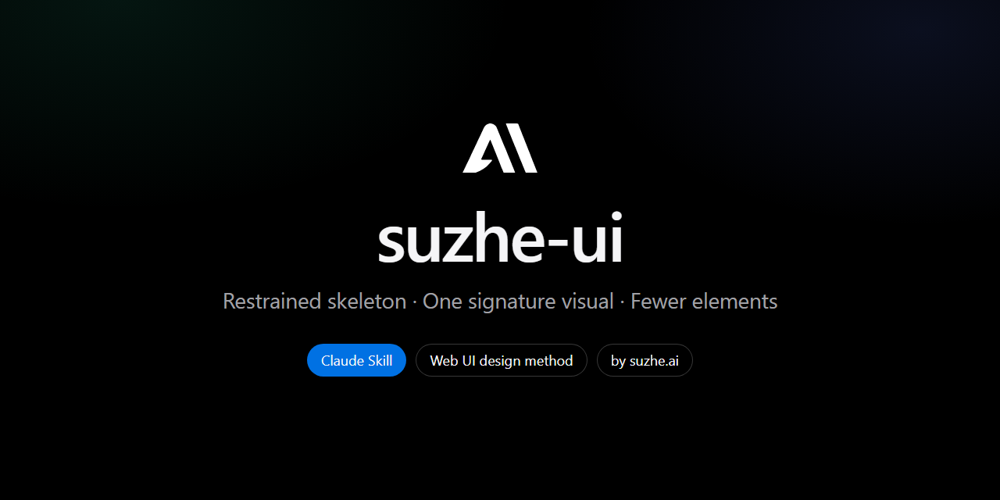
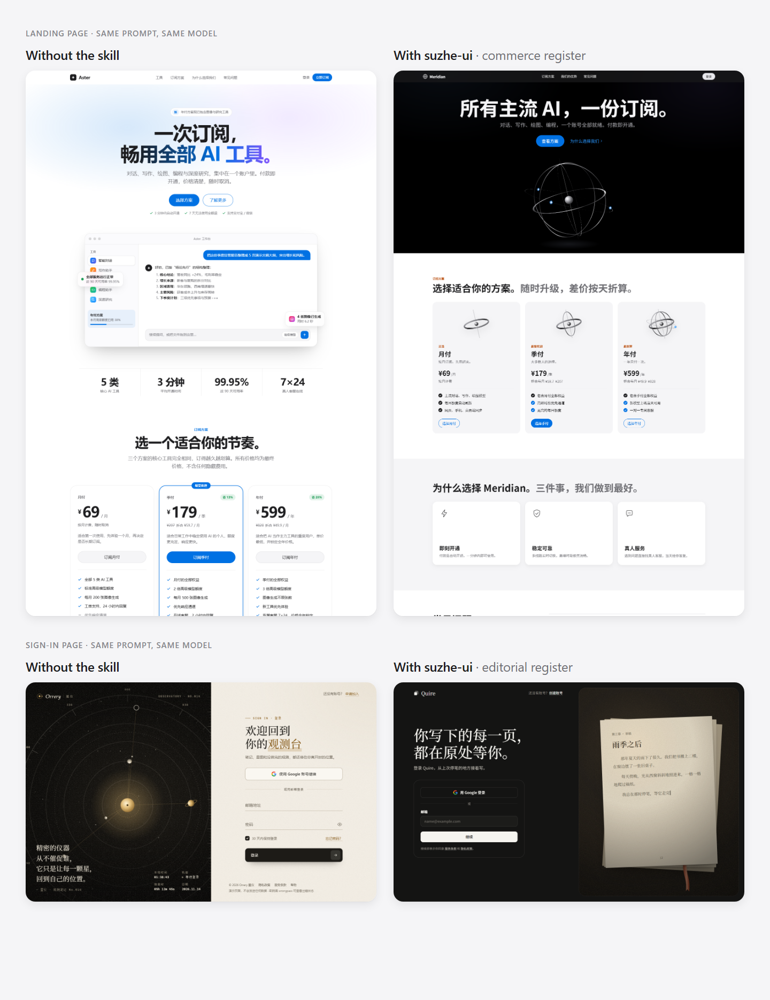

<p align="center">
  
</p>

<p align="center">
  <a href="README.md">English</a> · <a href="README.zh-CN.md">简体中文</a> · <b>日本語</b> · <a href="README.ko.md">한국어</a>
</p>

<p align="center">
  <a href="LICENSE"></a>
  
  
</p>

# suzhe-ui

**suzhe-ui** は、[suzhe.ai](https://suzhe.ai) の Web デザイン手法を Claude に教える Claude Skill です。Apple 水準の抑制の効いた骨格、ページごとにひとつの主役ビジュアル、そして役に立たない要素は置かない。

一度インストールすれば、Claude が Web ページを作ったりリデザインしたりするたびに、この手法で進めます。

<p align="center">
  
  <br><sub>同じプロンプト、同じモデル。左：Skill なし。右：suzhe-ui あり。</sub>
</p>

## 手法

1. **まずページの種類とトーンを決める。** ブランドページと購入フローは**コマースのトーン**、サインイン・会社紹介・シェアカードのような**アイデンティティの瞬間**は**エディトリアルのトーン**。正式なページ（ドキュメント・規約・お知らせ）とツール（メール・管理画面）にはそれぞれのルールがあります。1 ページに 1 つのトーン。
2. **コマースのトーン。** 背景は白、`#f5f5f7`、黒の 3 色だけを交互に使い、隣り合うセクションは同じ色にしない。システムフォント、アクセントは `#0071e3` の 1 色、ボタンはピル型。他社ブランドの色はアクセントにとどめる。
3. **エディトリアルのトーン。** 温かみのある紙色（`#faf9f5`）または温かい黒（`#141413`）、セリフ体の一文、青ではなくインク色のボタン、細い罫線、重い影は使わない。
4. **主役。** すべてのページに、*その製品*と*その目的*のためのビジュアルをひとつ。誰かのトップページの模倣はしない。
5. **少なく。** 使えないものは表示しない。ヘルプは一文。結果ページには結果だけ。
6. **タイミング。** ヒントはユーザーが本当に手順を抜かしたときだけ。モーションは状態の変化を示すためだけに使い、完了は「爆発」ではなく「光る」。
7. **どの端末でも滑らかに。** フラッグシップ機では美しく、安価なスマホでも滑らかに。重いエフェクトは端末性能に応じて段階的に軽くする。
8. **少しずつ改善する。** ユーザーが使い慣れたページを一度に作り直さない。

すべてのルールは稼働中のサイトでの実際のリデザインから生まれ、**却下された 16 のアプローチとその理由**（[`rejected.md`](skills/suzhe-ui/references/rejected.md)）も含まれます。

## インストール

### Claude Code — プラグインとして

```text
/plugin marketplace add suzhe-ai/suzhe-ui
/plugin install suzhe-ui@suzhe-ui
```

### Claude Code — 手動でコピー

```bash
git clone https://github.com/suzhe-ai/suzhe-ui.git
cp -r suzhe-ui/skills/suzhe-ui ~/.claude/skills/
```

特定のプロジェクトだけで使う場合は、`<プロジェクト>/.claude/skills/` にコピーしてください。

### Claude.ai

[最新リリース](https://github.com/suzhe-ai/suzhe-ui/releases/latest)から `suzhe-ui.zip` をダウンロードし、**Customize → Skills → + → Upload a skill** でアップロードします。

## 使い方

呼び出す必要はありません。作りたいものをそのまま伝えてください。

- 「AI サブスクリプションサービスのランディングページを作って」
- 「このログインページを高級感のあるものにして。よくある白いカードは避けて」
- 「このページはごちゃごちゃしているので整理して」

「suzhe-ui を使って」と明示しても構いません。Skill 本文は英語で書かれており、どの言語でも機能します。ページの文言はあなたの言語で書かれます。

## 中身

```text
skills/suzhe-ui/
├── SKILL.md                  手法の本体：ページの種類、骨格、主役、少なく、タイミング、一貫性
├── references/
│   ├── tokens.css            デザイントークンと基本スタイル（そのままコピー可）
│   ├── components.md         ナビ、ヒーロー、セクション、カード、ボタン、フォーム、モーダル、トースト、フッター
│   ├── page-types.md         ブランド / アイデンティティ / 正式 / ツール / フロー
│   ├── motion-perf.md        モーションの原則、長い処理の進捗表示、端末性能に応じたエフェクト
│   ├── rejected.md           却下された 16 のアプローチとその理由
│   └── checklist.md          実装の落とし穴と公開前チェックリスト
├── assets/starter.html       トークンで作ったブランドページのひな形
└── evals/                    テストケース（`claude plugin eval` で実行可能）
```

## コミュニティ

| | |
|---|---|
| Web サイト | [suzhe.ai](https://suzhe.ai) |
| Telegram グループ | [t.me/suzheaichat](https://t.me/suzheaichat) |
| Telegram チャンネル | [t.me/suzheaichannel](https://t.me/suzheaichannel) |
| Telegram で Suzhe に連絡 | [@RJ_HeatDeath](https://t.me/RJ_HeatDeath) |
| QQ グループ | 1131825420 |

Issue と Pull Request を歓迎します。

## ライセンス

[Apache License 2.0](LICENSE)。Suzhe AI の名称とロゴはライセンスの対象外です。詳しくは [NOTICE](NOTICE) をご覧ください。
