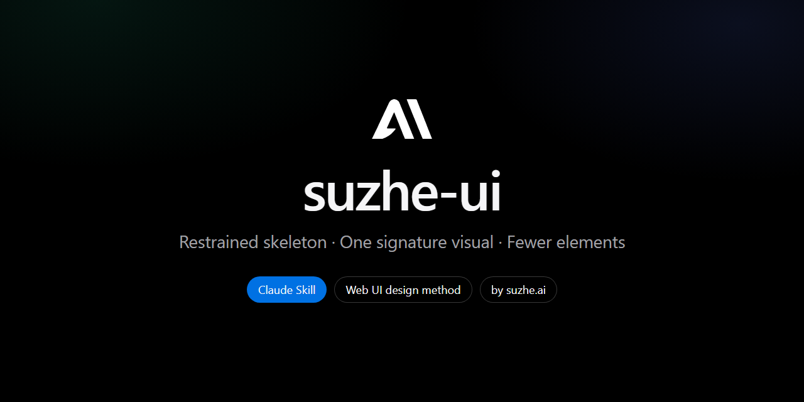
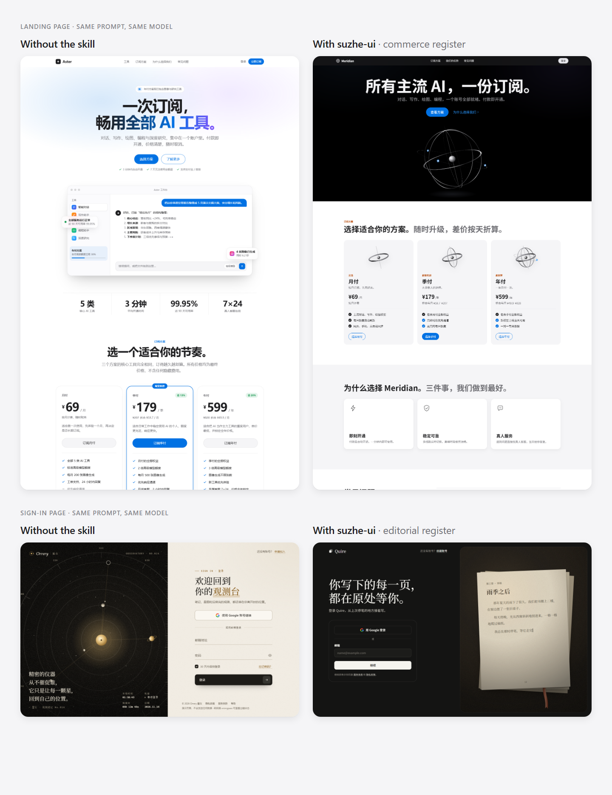

<p align="center">
  
</p>

<p align="center">
  <a href="README.md">English</a> · <a href="README.zh-CN.md">简体中文</a> · <a href="README.ja.md">日本語</a> · <b>한국어</b>
</p>

<p align="center">
  <a href="LICENSE"></a>
  
  
</p>

# suzhe-ui

**suzhe-ui**는 [suzhe.ai](https://suzhe.ai)의 웹 디자인 방법을 Claude에게 가르치는 Claude Skill입니다. Apple 수준의 절제된 골격, 페이지마다 하나의 주인공 비주얼, 그리고 제 몫을 하지 못하는 요소는 넣지 않습니다.

한 번만 설치하면 됩니다. 그 뒤로 Claude가 웹 페이지를 만들거나 다시 디자인할 때마다 이 방식으로 작업합니다.

<p align="center">
  
  <br><sub>같은 프롬프트, 같은 모델. 왼쪽: Skill 없음. 오른쪽: suzhe-ui 사용.</sub>
</p>

## 방법

1. **먼저 페이지 유형과 톤을 정합니다.** 브랜드 페이지와 구매 흐름은 **커머스 톤**, 로그인·회사 소개·공유 카드 같은 **아이덴티티 순간**은 **에디토리얼 톤**을 씁니다. 공식 페이지(문서·약관·공지)와 도구(메일·관리자 화면)에는 각자의 규칙이 있습니다. 한 페이지에는 한 가지 톤만.
2. **커머스 톤.** 배경은 흰색, `#f5f5f7`, 검정 세 가지만 번갈아 쓰고, 인접한 섹션은 같은 색이 되지 않게 합니다. 시스템 폰트, 강조색은 `#0071e3` 하나, 알약 모양 버튼. 다른 브랜드의 색은 포인트로만 씁니다.
3. **에디토리얼 톤.** 따뜻한 종이색(`#faf9f5`) 또는 따뜻한 검정(`#141413`), 세리프체 한 문장, 파란색 대신 잉크색 버튼, 얇은 테두리, 무거운 그림자는 쓰지 않습니다.
4. **주인공.** 모든 페이지에 *이 제품*과 *이 작업*에 맞는 비주얼을 하나 둡니다. 남의 홈페이지를 베끼지 않습니다.
5. **더 적게.** 사용할 수 없는 항목은 보여주지 않습니다. 도움말은 한 문장. 결과 페이지에는 결과만.
6. **타이밍.** 힌트는 사용자가 실제로 단계를 빠뜨렸을 때만. 모션은 상태 변화를 표시할 때만 쓰고, 완료는 "폭발"이 아니라 "빛나게".
7. **모든 기기에서 매끄럽게.** 플래그십 기기에서는 아름답게, 저가 스마트폰에서도 매끄럽게. 무거운 효과는 기기 성능에 따라 단계적으로 줄입니다.
8. **점진적으로 개선합니다.** 사용자가 이미 익숙한 페이지를 한 번에 갈아엎지 않습니다.

모든 규칙은 운영 중인 사이트의 실제 리디자인에서 나왔으며, **반려된 16가지 접근과 그 이유**([`rejected.md`](skills/suzhe-ui/references/rejected.md))도 포함됩니다.

## 설치

### Claude Code — 플러그인으로 설치

```text
/plugin marketplace add suzhe-ai/suzhe-ui
/plugin install suzhe-ui@suzhe-ui
```

### Claude Code — 직접 복사

```bash
git clone https://github.com/suzhe-ai/suzhe-ui.git
cp -r suzhe-ui/skills/suzhe-ui ~/.claude/skills/
```

특정 프로젝트에서만 쓰려면 `<프로젝트>/.claude/skills/`에 복사하세요.

### Claude.ai

[최신 릴리스](https://github.com/suzhe-ai/suzhe-ui/releases/latest)에서 `suzhe-ui.zip`을 내려받아 **Customize → Skills → + → Upload a skill**에서 업로드하세요.

## 사용법

따로 호출할 필요가 없습니다. 원하는 것을 그대로 말하면 됩니다.

- "AI 구독 서비스 랜딩 페이지를 만들어 줘."
- "이 로그인 페이지를 고급스럽게 바꿔 줘. 흔한 흰색 카드는 빼고."
- "이 페이지가 너무 복잡해. 정리해 줘."

"suzhe-ui를 써 줘"라고 직접 말해도 됩니다. Skill 본문은 영어로 작성되어 어떤 언어에서든 작동하며, 페이지 문구는 사용자의 언어로 씁니다.

## 구성

```text
skills/suzhe-ui/
├── SKILL.md                  방법의 본문: 페이지 유형, 골격, 주인공, 더 적게, 타이밍, 일관성
├── references/
│   ├── tokens.css            디자인 토큰과 기본 스타일(그대로 복사 가능)
│   ├── components.md         내비게이션, 히어로, 섹션, 카드, 버튼, 폼, 모달, 토스트, 푸터
│   ├── page-types.md         브랜드 / 아이덴티티 / 공식 / 도구 / 플로우 페이지
│   ├── motion-perf.md        모션 원칙, 긴 작업의 진행 표시, 기기 성능별 효과
│   ├── rejected.md           반려된 16가지 접근과 그 이유
│   └── checklist.md          구현 시 함정과 배포 전 점검표
├── assets/starter.html       토큰으로 만든 브랜드 페이지 시작 템플릿
└── evals/                    테스트 케이스(`claude plugin eval`로 실행 가능)
```

## 커뮤니티

| | |
|---|---|
| 웹사이트 | [suzhe.ai](https://suzhe.ai) |
| Telegram 그룹 | [t.me/suzheaichat](https://t.me/suzheaichat) |
| Telegram 채널 | [t.me/suzheaichannel](https://t.me/suzheaichannel) |
| Telegram으로 Suzhe에게 연락 | [@RJ_HeatDeath](https://t.me/RJ_HeatDeath) |
| QQ 그룹 | 1131825420 |

Issue와 Pull Request를 환영합니다.

## 라이선스

[Apache License 2.0](LICENSE). Suzhe AI의 이름과 로고는 라이선스 대상이 아닙니다. 자세한 내용은 [NOTICE](NOTICE)를 참고하세요.
