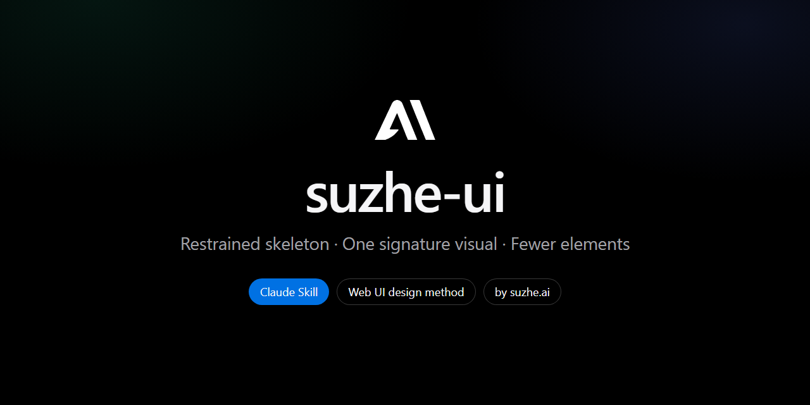
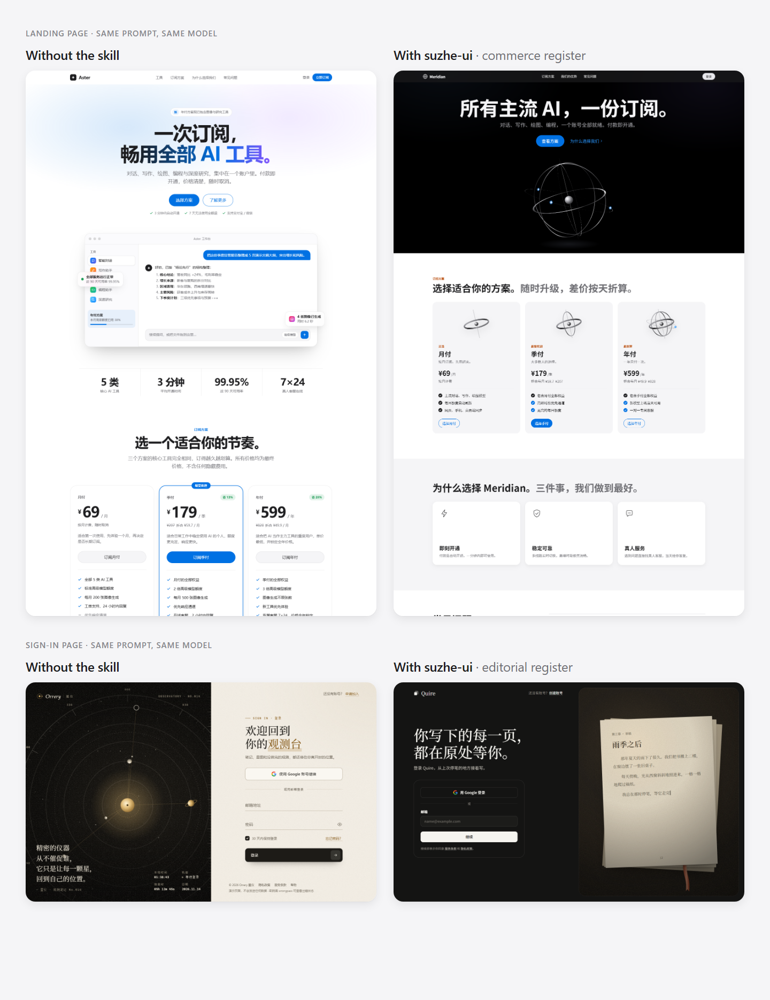

<p align="center">
  
</p>

<p align="center">
  <b>English</b> · <a href="README.zh-CN.md">简体中文</a> · <a href="README.ja.md">日本語</a> · <a href="README.ko.md">한국어</a>
</p>

<p align="center">
  <a href="LICENSE"></a>
  
  
</p>

# suzhe-ui

**suzhe-ui** is a Claude Skill that teaches Claude the web design method behind [suzhe.ai](https://suzhe.ai): an Apple-grade restrained skeleton, one signature visual per page, and nothing that doesn't earn its place.

Install it once. From then on, whenever Claude builds or redesigns a web page, it works this way.

<p align="center">
  
  <br><sub>Same prompt, same model. Left: without the skill. Right: with suzhe-ui.</sub>
</p>

## The method

1. **Know the page type and its register first.** Brand pages and shop flows speak the **commerce register**; sign-in, about pages and share cards are **identity moments** in the **editorial register**; formal pages (docs, terms, notices) and tools (mail, dashboards) have their own rules. One page, one register.
2. **Commerce register.** Three backgrounds only — white, `#f5f5f7`, black — alternating so adjacent sections never match. System fonts. One accent, `#0071e3`. Pill buttons. Third-party brand colours are accents, never full-bleed fills.
3. **Editorial register.** Warm paper (`#faf9f5`) or warm black (`#141413`), one serif statement, ink buttons instead of blue, thin borders, no heavy shadows.
4. **Signature.** Every page gets one visual that belongs to *this* product and *this* task — never a copy of someone else's homepage.
5. **Less.** Hide what is unavailable. Help text is one sentence. Result pages show the result and nothing else.
6. **Timing.** Hints appear only when the user has actually missed something. Motion marks state changes; completion glows, it doesn't explode.
7. **Smooth on every device.** Beautiful on a flagship *and* fluid on a cheap phone — heavy effects degrade by device tier.
8. **Improve incrementally.** Never rebuild a page people already find comfortable in one go.

Every rule comes from real redesign rounds on a live site, including **16 rejected attempts and why they failed** ([`rejected.md`](skills/suzhe-ui/references/rejected.md)).

## Install

### Claude Code — as a plugin

```text
/plugin marketplace add suzhe-ai/suzhe-ui
/plugin install suzhe-ui@suzhe-ui
```

### Claude Code — manual copy

```bash
git clone https://github.com/suzhe-ai/suzhe-ui.git
cp -r suzhe-ui/skills/suzhe-ui ~/.claude/skills/
```

To use it in a single project only, copy it to `<your-project>/.claude/skills/` instead.

### Claude.ai

Download `suzhe-ui.zip` from the [latest release](https://github.com/suzhe-ai/suzhe-ui/releases/latest), then upload it in **Customize → Skills → + → Upload a skill**.

## Usage

There is nothing to call. Just ask for what you want:

- "Build a landing page for my AI subscription service."
- "Make this login page feel premium, not like every other white card."
- "This page is cluttered. Clean it up."

You can also say "Use suzhe-ui" explicitly. The skill is written in English and works in any language; Claude writes your page copy in your language. A full Chinese edition lives in [`docs/zh-CN`](docs/zh-CN/SKILL.md).

## What's inside

```text
skills/suzhe-ui/
├── SKILL.md                  The method: page types & registers, skeleton, signature, less, timing, consistency
├── references/
│   ├── tokens.css            Tokens for both registers and base styles, ready to copy
│   ├── components.md         Nav, hero, sections, cards, buttons, forms, modals, toasts, footer
│   ├── page-types.md         Brand, identity, formal, tool and flow pages
│   ├── motion-perf.md        Motion rules, long-task progress, device-tiered effects
│   ├── rejected.md           16 rejected approaches and why
│   └── checklist.md          Engineering pitfalls and a pre-ship checklist
├── assets/starter.html       A starter brand page built on the tokens
└── evals/                    Test cases, runnable with `claude plugin eval`
docs/zh-CN/                   Full Chinese edition (中文版)
```

## Community

| | |
|---|---|
| Website | [suzhe.ai](https://suzhe.ai) |
| Telegram group | [t.me/suzheaichat](https://t.me/suzheaichat) |
| Telegram channel | [t.me/suzheaichannel](https://t.me/suzheaichannel) |
| Contact Suzhe on Telegram | [@RJ_HeatDeath](https://t.me/RJ_HeatDeath) |
| QQ group | 1131825420 |

Issues and pull requests are welcome.

## License

[Apache License 2.0](LICENSE). The Suzhe AI names and logo are not covered by the license; see [NOTICE](NOTICE).
