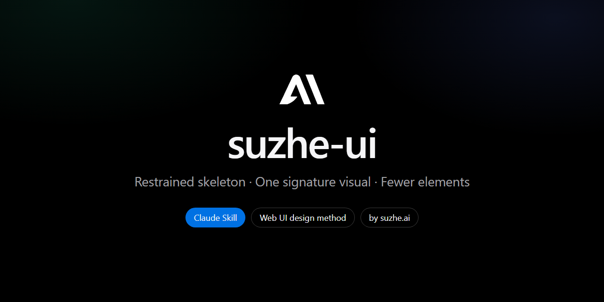
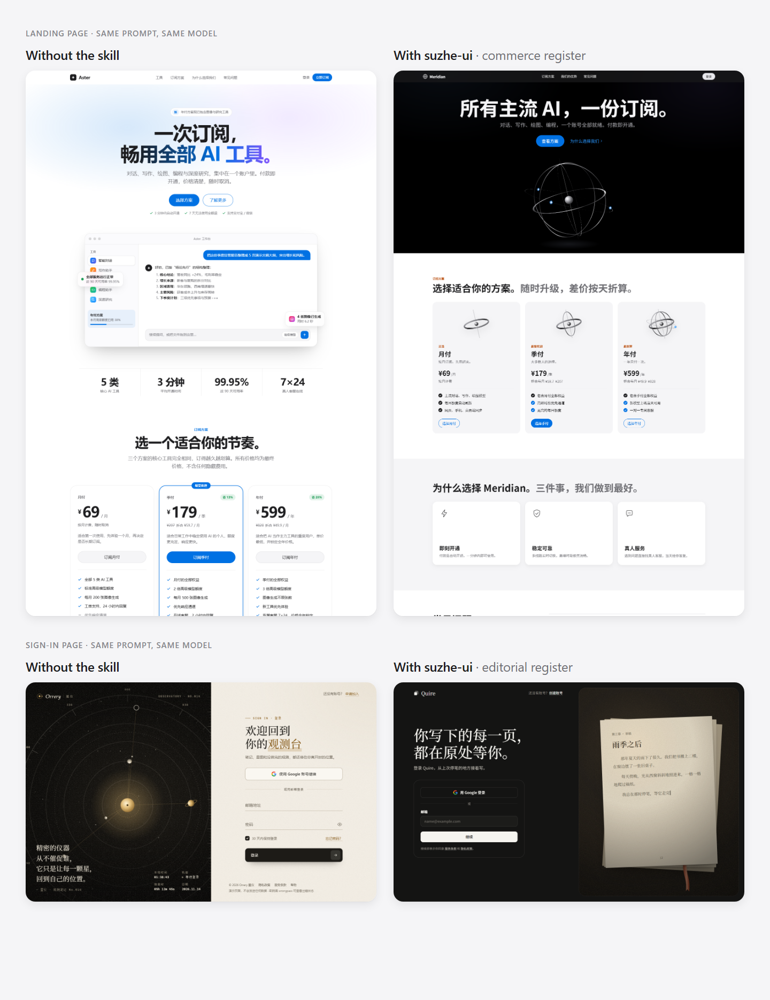

<p align="center">
  
</p>

<p align="center">
  <a href="README.md">English</a> · <b>简体中文</b> · <a href="README.ja.md">日本語</a> · <a href="README.ko.md">한국어</a>
</p>

<p align="center">
  <a href="LICENSE"></a>
  
  
</p>

# 苏哲 UI（suzhe-ui）

**苏哲 UI** 是一个 Claude Skill。它把 [suzhe.ai](https://suzhe.ai) 的网页设计方法写成了 Claude 能直接照做的说明：苹果级的克制骨架，每页一个专属主角，再把没用的东西全部拿掉。

装一次就行。之后 Claude 每次做网页、改界面，都会按这套方法来。

<p align="center">
  
  <br><sub>同一句需求、同一个模型。左：没装 skill；右：装了苏哲 UI。</sub>
</p>

## 方法

1. **先判断页面类型和语气。** 品牌页和购买流程用**商务语气**；登录、关于我们、分享卡片这类**身份时刻**用**编辑语气**；正式页（文档、条款、公告）和工具页（邮箱、后台）各有规矩。一个页面只用一种语气。
2. **商务语气。** 底色只有白、`#f5f5f7`、黑三种，交替使用，相邻区块不同色。系统字体。只有一个强调色 `#0071e3`。胶囊按钮。第三方品牌色只做点缀，不整块铺底。
3. **编辑语气。** 暖纸白（`#faf9f5`）或暖黑（`#141413`），一句衬线大字，墨色按钮代替蓝色，细边框，不加重阴影。
4. **主角。** 每个页面一个属于「这个产品、这个任务」的视觉主角，不照搬任何人的官网。
5. **少。** 不可用的东西不显示。帮助文案一句话。结果页只显示结果。
6. **时机。** 提示只在用户真的漏了一步时出现。动效只表示状态变化；完成时要「亮」，不要「炸」。
7. **每台设备都流畅。** 旗舰机上惊艳，便宜手机上也丝滑；重特效按设备分档降级。
8. **渐进改版。** 用户已经用顺手的页面，不整页推倒重做。

每条规则都来自线上网站的真实改版，其中包括 **16 种被否掉的做法和原因**（[`rejected.md`](docs/zh-CN/references/rejected.md)）。

## 安装

### Claude Code：作为插件安装

```text
/plugin marketplace add suzhe-ai/suzhe-ui
/plugin install suzhe-ui@suzhe-ui
```

### Claude Code：手动复制

```bash
git clone https://github.com/suzhe-ai/suzhe-ui.git
cp -r suzhe-ui/skills/suzhe-ui ~/.claude/skills/
```

只想在某一个项目里用，就复制到 `<你的项目>/.claude/skills/`。

### Claude.ai 网页版

在[最新版本](https://github.com/suzhe-ai/suzhe-ui/releases/latest)下载 `suzhe-ui.zip`，然后在 **Customize → Skills → + → Upload a skill** 上传。

## 用法

不用特意调用，直接说你要什么：

- 「帮我做一个 AI 订阅服务的首页。」
- 「把这个登录页做得高级一点，别做成千篇一律的白卡片。」
- 「这个页面太乱了，帮我整理一下。」

也可以直接说「用苏哲 UI 来做」。Skill 正文是英文（全球通用），对任何语言都有效，页面文案会用你的语言写。完整中文版在 [`docs/zh-CN`](docs/zh-CN/SKILL.md)。

## 里面有什么

```text
skills/suzhe-ui/
├── SKILL.md                  方法主文：页面类型与语气、骨架、主角、少、时机、一致
├── references/
│   ├── tokens.css            两种语气的设计变量与基础样式，可以直接拷贝
│   ├── components.md         导航、首屏、区块、卡片、按钮、表单、弹窗、提示、页脚
│   ├── page-types.md         品牌页、身份时刻、正式页、工具页、流程页
│   ├── motion-perf.md        动效分寸、长任务进度、按设备分档的特效
│   ├── rejected.md           16 种被否掉的做法和原因
│   └── checklist.md          工程坑与交付前验收清单
├── assets/starter.html       用这套变量写好的品牌页起步模板
└── evals/                    测试用例，可以用 `claude plugin eval` 运行
docs/zh-CN/                   完整中文版
```

## 交流

| | |
|---|---|
| 官网 | [suzhe.ai](https://suzhe.ai) |
| Telegram 交流群 | [t.me/suzheaichat](https://t.me/suzheaichat) |
| Telegram 官方频道 | [t.me/suzheaichannel](https://t.me/suzheaichannel) |
| Telegram 联系苏哲 | [@RJ_HeatDeath](https://t.me/RJ_HeatDeath) |
| QQ 群 | 1131825420 |

欢迎提 Issue 和 Pull Request。

## 协议

[Apache License 2.0](LICENSE)。「苏哲 AI」等名称和标志不在授权范围内，详见 [NOTICE](NOTICE)。
